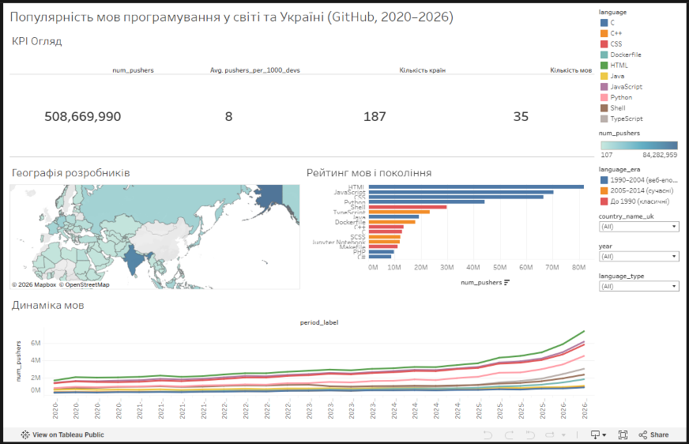

# Дослідження популярності мов програмування (Курсова робота, тема № 12)

Проєкт із курсу **«Мови програмування для аналізу даних»**  
Національний університет «Полтавська політехніка імені Юрія Кондратюка»  
Навчально-науковий інститут інформаційних технологій та робототехніки  
Кафедра комп’ютерних та інформаційних технологій і систем  

- **Виконавець:** студент групи **401-ТН** спеціальності **122 «Комп’ютерні науки»** Литвин Назар Андрійович  
- **Керівник:** старший викладач Гайтан Олена Миколаївна  
- **Рік:** 2026

---

## Мета проєкту
Дослідити глобальну та національну (зокрема українську) динаміку популярності мов програмування за період **2020 Q1 – 2026 Q2**, перевірити узгодженість між реальною активністю розробників на GitHub та екосистемними характеристиками мов (оцінкою кількості користувачів, вакансій, літератури, віком мови), а також створити відтворюваний програмний конвеєр та інтерактивну аналітичну панель.

## Інтерактивний дашборд (Tableau Public)

Опублікована інтерактивна аналітична панель доступна за посиланням:  
**[Популярність мов програмування у світі та Україні (GitHub, 2020–2026)](https://public.tableau.com/app/profile/nazar.lytvyn6453/viz/GitHub20202026/sheet4)**



---

## Джерела даних
У роботі об’єднано **чотири відкриті таблиці**:
1. **GitHub Innovation Graph** ([github.com/github/innovationgraph](https://github.com/github/innovationgraph), ліцензія CC-BY-4.0 / відкриті дані):
   - `data/raw/languages.csv` — поквартальна кількість унікальних розробників (`num_pushers`), які здійснювали push-події за мовами (класифікація Linguist) і країнами ISO-2 (2020 Q1 – 2026 Q2, 190 246 рядків).
   - `data/raw/developers.csv` — загальна кількість активних облікових записів розробників за країнами та кварталами (5 888 рядків).
   - `data/raw/repositories.csv` — загальна кількість репозиторіїв за країнами та кварталами (5 866 рядків).
2. **PLDB — Programming Language DataBase** ([pldb.info](https://pldb.info/pldb.csv), суспільне надбання CC0):
   - `data/raw/pldb.csv` — база знань про понад 5 000 мов програмування: рік появи (`appeared`), інтегральний рейтинг `pldbScore`, оцінка користувачів і вакансій, кількість книг та відвідуваність Wikipedia (5 159 рядків, 403 ознаки).

> Усі сирі CSV-файли завантажуються автоматично з офіційних репозиторіїв скриптом `src/fetch_data.py`.

---

## Структура проєкту

```text
курсова робота/
├── data/
│   ├── raw/                     # Вихідні CSV-файли (GitHub Innovation Graph + PLDB)
│   └── processed/               # Зведені набори (languages_enriched.csv генерується локально через analysis_pipeline.py)
├── notebooks/
│   └── analysis.ipynb           # Основний Jupyter Notebook із повним циклом аналізу
├── src/
│   ├── fetch_data.py            # Скрипт автоматичного завантаження вихідних даних
│   └── analysis_pipeline.py     # Модульний аналітичний конвеєр і генератор графіків
├── results/
│   ├── figures/                 # 8 графіків Matplotlib / Seaborn (300 DPI PNG)
│   └── exports/                 # Таблиці статистик, зведені таблиці, JSON-метрики
├── tableau/
│   ├── tableau_coursework_data.xlsx   # Підготовлена книга Excel для Tableau Public
│   ├── tableau_languages_main.csv     # Поквартальні дані по Топ-35 мовах
│   ├── tableau_language_summary.csv   # Зведений профіль мов + PLDB
│   ├── dashboard_screenshot.png       # Скриншот опублікованої панелі Tableau Public
│   └── README_TABLEAU.md              # Інструкція зі створення дашборду
├── requirements.txt
├── .gitignore
└── README.md
```

---

## Технології
- **Python 3.12**, **Pandas 3.1**, **NumPy 2.5**, **SciPy 1.18** — очищення, злиття (`merge`), інженерія ознак, статистичний і кореляційний аналіз.
- **Matplotlib 3.11**, **Seaborn 0.13** — статистична візуалізація (8 графіків).
- **Jupyter Notebook (`nbformat`, `nbclient`)** — інтерактивне документування й відтворюваний запуск.
- **Tableau Public** — інтерактивний дашборд.

---

## Інструкція із запуску та відтворення

1. **Встановити залежності** (у віртуальному середовищі або системному Python 3.10+):
   ```powershell
   pip install -r requirements.txt
   ```
2. **Завантажити вихідні дані** (якщо каталог `data/raw/` порожній або потрібно оновити дані):
   ```powershell
   python src/fetch_data.py
   ```
3. **Запустити повний аналітичний конвеєр**:
   ```powershell
   python src/analysis_pipeline.py
   ```
   У результаті оновляться файли в `data/processed/`, `results/exports/`, `results/figures/` та `tableau/`.
4. **Відкрити або повторно виконати Jupyter Notebook**:
   ```powershell
   jupyter notebook notebooks/analysis.ipynb
   ```
   Або через командний рядок без UI (використовуючи `nbclient`):
   Усі комірки `notebooks/analysis.ipynb` виконуються послідовно без помилок.
5. **Переглянути або відтворити дашборд у Tableau Public**:
   - Опублікована інтерактивна панель: [Популярність мов програмування у світі та Україні (GitHub, 2020–2026)](https://public.tableau.com/app/profile/nazar.lytvyn6453/viz/GitHub20202026/sheet4)
   - Покрокова інструкція для повторного розгортання: [`tableau/README_TABLEAU.md`](tableau/README_TABLEAU.md).
